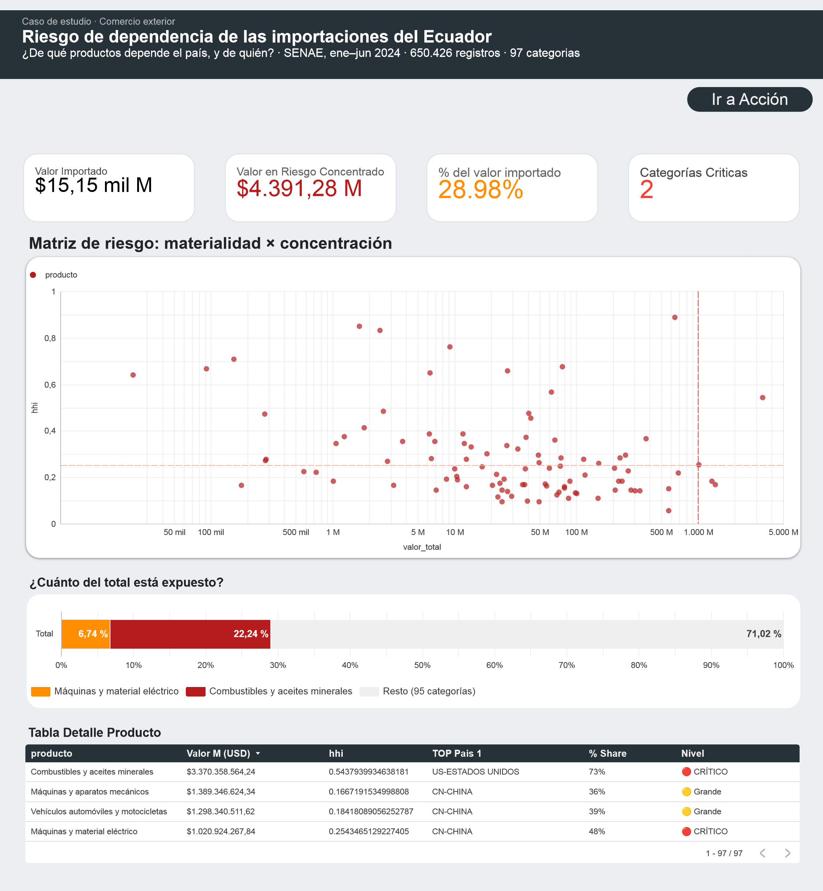
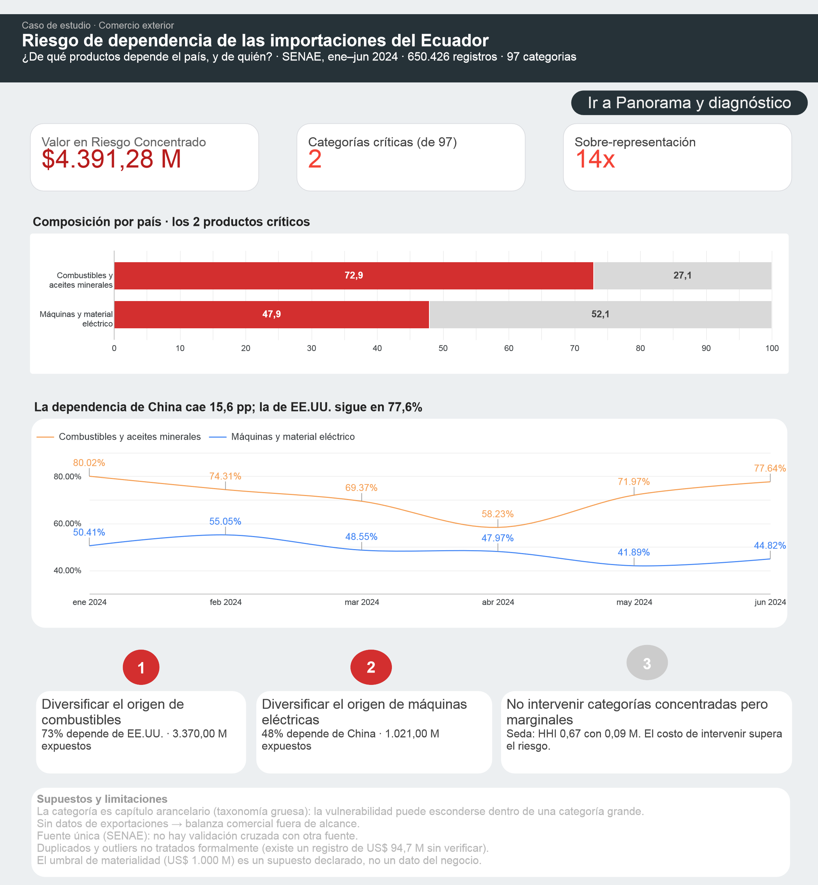

# Riesgo de dependencia de las importaciones del Ecuador

**¿Dónde es más vulnerable el suministro del país?**
Análisis de 650.426 declaraciones de importación · enero–junio 2024 · fuente SENAE

> **Hallazgo principal:** solo **2 de las 97** categorías arancelarias (2,1%) concentran el
> **29% del valor importado** — catorce veces su peso esperado. En ambas, un solo país proveedor
> domina la oferta: **73% desde EE.UU.** (combustibles) y **48% desde China** (máquinas eléctricas).

---

## Contenido del repositorio

```
├── README.md                          # este documento
├── sql/
│   └── riesgo_importaciones.sql       # Consultas 1-6 (BigQuery Standard SQL)
└── docs/                              # capturas del dashboard
```

**Entregables:** [dashboard en Looker Studio](https://datastudio.google.com/reporting/14ae0988-c823-4440-8576-881834f97b6c) ·
análisis completo en este README.

---

## 1. Pregunta de negocio

| Campo | Definición |
|---|---|
| **Pregunta** | ¿Dónde es más vulnerable el suministro de importaciones del Ecuador? |
| **Decisor** | Analista de comercio exterior / gerencia de compras y abastecimiento |
| **Decisión que habilita** | En qué categorías priorizar la diversificación de proveedores (y en cuáles no gastar esfuerzo) |
| **Indicador principal** | Doble dependencia: concentración (HHI) × materialidad (valor importado) |

El objetivo no era "explorar un dataset", sino responder una pregunta con consecuencia práctica:
**si hoy se interrumpe el suministro desde un país, ¿qué parte del comercio ecuatoriano queda expuesta?**

---

## 2. Impacto en una frase

> De cada **US$100** que Ecuador importó en el primer semestre de 2024, **casi US$29** están en solo
> dos productos cuya oferta depende de un país dominante.

| Métrica | Valor |
|---|---|
| Valor importado total (ene–jun 2024) | **US$ 15.154,99 M** |
| Valor en categorías críticas | **US$ 4.391,28 M** |
| **% del valor importado en riesgo concentrado** | **28,98%** |
| Categorías críticas | **2 de 97** (2,06%) |
| Sobre-representación | **14,1×** su peso esperado |

---

## 3. Datos y calidad

| Campo | Valor |
|---|---|
| Fuente | SENAE — Declaraciones aduaneras de importación (régimen general) |
| Portal | [datosabiertos.gob.ec](https://www.datosabiertos.gob.ec/dataset/datos-de-declaraciones-aduaneras-de-importacion-regimen-general/resource/c2a28c79-2243-4fcb-8a23-d8bc91ca6837) |
| Licencia | Creative Commons Attribution (Open Data) |
| Volumen | 650.426 filas · 199 MB |
| Periodo | 2024-01-01 → 2024-06-30 |
| Variables usadas | `categoria` (capítulo arancelario), `PAIS_ORIGEN`, `FOB` |

**Evaluación de calidad (probe previo al análisis):**

| Chequeo | Resultado |
|---|---|
| Nulos en `categoria` / `PAIS_ORIGEN` / `FOB` | 0 / 0 / 0 |
| `FOB` ≤ 0 | 0 registros |
| Rango de `FOB` | US$ 0,002 – US$ 94.759.381,33 |

Aunque el dataset llegó limpio, se mantiene un filtro de blindaje
(`WHERE FOB > 0 AND PAIS_ORIGEN IS NOT NULL`) para que un recargue con datos sucios no rompa el KPI.

---

## 4. Método

### Indicadores

| KPI | Fórmula | Qué responde |
|---|---|---|
| `share` | valor del país ÷ valor total del producto | peso de cada proveedor |
| **`hhi`** | Σ (share²) | **¿qué tan concentrada está la oferta?** Va de ~0 (repartido) a 1 (un solo país) |
| `share_top5` | suma de los 5 mayores shares | dependencia del bloque principal |
| `top1_share` | share del mayor proveedor | dependencia del país dominante |
| `valor_total` | suma de FOB del producto | materialidad: cuánto dinero hay ahí |

**Escala HHI aplicada** (normalizada): `< 0,15` desconcentrado · `0,15–0,25` moderado · `≥ 0,25` altamente concentrado.

### Matriz de riesgo 2×2

La concentración sola no basta: un producto puede ser un monopolio y no importar nada.
Por eso se cruzan **concentración** × **materialidad**.

```
                          valor_total ≥ US$ 1.000 M
                                  NO            SÍ
                ┌──────────────────┬──────────────────┐
   hhi ≥ 0,25 SÍ│  Concentrado     │  🔴 CRÍTICO      │
                ├──────────────────┼──────────────────┤
              NO│  ⚪ OK           │  🟡 Grande       │
                └──────────────────┴──────────────────┘
```

- **Umbral de concentración (`hhi ≥ 0,25`):** estándar internacional. No es un valor elegido a gusto.
- **Umbral de materialidad (`≥ US$ 1.000 M`):** **supuesto declarado**, no un dato. Se documenta
  como decisión propia y es el primer parámetro a revisar si el negocio define otra prioridad.

### Técnicas SQL utilizadas

CTEs encadenadas · `SUM() OVER (PARTITION BY ...)` · `ROW_NUMBER() OVER (...)` ·
agregación condicional (`SUM(IF(...))`, `MAX(IF(...))`, `COUNTIF(...)`) · `SAFE_DIVIDE` · `CASE WHEN`.

---

## 5. Hallazgos

### 5.1 Las dos categorías críticas

| Categoría | HHI | Proveedor dominante | Share | Valor |
|---|---|---|---|---|
| Combustibles y aceites minerales | **0,544** | EE.UU. | **73%** | **US$ 3.370 M** |
| Máquinas y material eléctrico | **0,254** | China | **48%** | **US$ 1.021 M** |

**Lectura:** las dos categorías más grandes que importa el Ecuador son también las dos más
concentradas. **El riesgo no está repartido: está donde está el dinero.**

### 5.2 Concentración ≠ materialidad

| Categoría | HHI | Share del top 1 | Valor | Nivel |
|---|---|---|---|---|
| Seda | 0,665 | 79% | **US$ 0,09 M** | Concentrado (irrelevante) |
| Aeronaves y vehículos espaciales | 0,888 | 94% | US$ 648 M | Concentrado |
| Combustibles | 0,544 | 73% | **US$ 3.370 M** | 🔴 Crítico |

Un HHI más alto **no** implica más riesgo. La seda es casi un monopolio y no mueve la aguja;
los combustibles tienen un HHI *menor* y exponen US$ 3.370 M. **Clasificar solo por concentración
habría priorizado un problema inexistente.**

### 5.3 Distribución

De 97 categorías, solo 2 son críticas. El resultado no es una lista de 30 alertas: es una lista
**corta y accionable** de 2 decisiones.

### 5.4 Evolución mensual de la dependencia

El share del proveedor dominante **no es estable** dentro del periodo:

| Mes | Combustibles (EE.UU.) | Máquinas (China) |
|---|---|---|
| ene 2024 | 80,02% | 60,41% |
| feb 2024 | 74,31% | 55,05% |
| mar 2024 | 69,37% | 48,55% |
| abr 2024 | 58,23% | 47,97% |
| may 2024 | 71,97% | 41,89% |
| jun 2024 | 77,64% | 44,82% |
| **Cambio ene→jun** | **−2,38 pp** | **−15,59 pp** |

**Lectura:** la dependencia de China en máquinas eléctricas cayó **15,6 puntos porcentuales** en
seis meses. La de EE.UU. en combustibles hizo un valle en abril y volvió a **77,64%** en junio:
sigue siendo el punto más expuesto del país.

**Precaución:** con 6 puntos mensuales y categorías concentradas, un solo embarque grande mueve el
share varios puntos. Esto es un **movimiento observado, no una tendencia establecida**.

**Validación:** el promedio simple de las series (71,9% y 49,8%) es coherente con el share del
periodo completo (73% y 48%); la diferencia se explica por el peso en valor de cada mes.

---

## 6. Recomendación

| Prioridad | Acción | Justificación |
|---|---|---|
| **1** | Diversificar el origen de **combustibles** | 73% depende de un solo país · US$ 3.370 M expuestos |
| **2** | Diversificar el origen de **máquinas y material eléctrico** | 48% depende de China · US$ 1.021 M expuestos |
| **3** | **No** asignar esfuerzo a categorías concentradas pero marginales | Seda: HHI 0,67 con US$ 0,09 M — el costo de intervenir supera el riesgo |

**Impacto:** US$ **4.391,28 M** (28,98% del valor importado del periodo) están expuestos a la
decisión de un solo proveedor. Cualquier plan de diversificación debería empezar por ahí.

---

## 7. Limitaciones

1. **`categoria` es capítulo arancelario** (taxonomía gruesa): la vulnerabilidad puede esconderse
   dentro de una categoría grande y no ser visible a este nivel.
2. **Sin datos de exportaciones** → la balanza comercial queda **fuera de alcance**.
3. **Fuente única** (SENAE) → no hay validación cruzada con otra fuente.
4. **Duplicados y outliers no tratados formalmente**: existe un registro con FOB de US$ 94,7 M
   sin verificar si es real o un error de carga.
5. **El umbral de materialidad (US$ 1.000 M) es un supuesto**, no un dato del negocio.
6. La categoría "Concentrado" es **heterogénea**: mezcla productos de US$ 92 K y de US$ 648 M.
7. **La serie mensual (6 puntos) es volátil**: un embarque puntual puede mover el share varios
   puntos porcentuales. Se lee como movimiento observado, no como tendencia.

---

## 8. Cómo reproducirlo

1. Descargar el dataset desde el portal de datos abiertos (enlace en la sección 3).
2. Cargarlo en BigQuery en un dataset llamado `ec`.
3. Crear la vista `ec.v_importaciones` con las columnas `categoria`, `PAIS_ORIGEN`, `FOB`,
   `FEC_INGRESO` *(ajustar si tu tabla de origen tiene otro nombre)*.
4. Ejecutar `sql/riesgo_importaciones.sql`:
   - **Consulta 1** → tabla de riesgo por producto (97 filas). Base del dashboard.
   - **Consulta 2** → impacto agregado (1 fila, 7 indicadores).
   - **Consulta 4** → evolución mensual del share del proveedor dominante (12 filas).
   - **Consultas 3, 5 y 6** → insumos auxiliares de visualización (detalle por país y bloques
     para la barra de exposición). No son necesarias para reproducir los hallazgos.

**Resultado esperado de la Consulta 2:** `15154.99 · 4391.28 · 28.98 · 97 · 2 · 2.06 · 14.1`

---

## 9. Stack y autor

- **SQL:** BigQuery (Standard SQL)
- **Visualización:** Looker Studio — [ver dashboard](https://datastudio.google.com/reporting/14ae0988-c823-4440-8576-881834f97b6c)
- **Autor:** Jackson Jeampiere Yangua Buenaño · [LinkedIn](https://linkedin.com/in/jackson-yangua-buenaño-756829278) · jacksonyangua2001@gmail.com

<!--
Capturas del dashboard. Guarda las imágenes en docs/ y descomenta estas líneas.



-->
